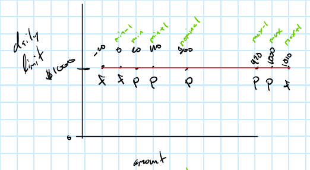
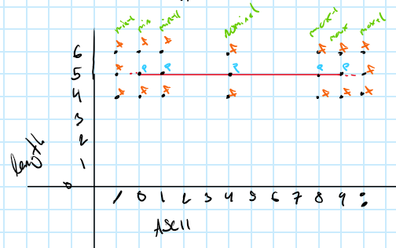

# Assignment 1 Documentation - Black Box Testing

---

## Section 1: Process and Assumptions

### Transfer Fee Calculation / Decision Table Analysis

#### Process

The specification defines four condition variables:
1. **$C_1$: Student Status (`student`)**: Boolean domain `{true, false}`. 
2. **$C_2$: Transfer Amount (`amount`)**:
- For students: partitioned at $\$200.00$ ($< \$200.00$ vs. $\ge \$200.00$).
- For non-students: partitioned at $\$100.00$ ($< \$100.00$ vs. $\ge \$100.00$).  
3. **$C_3$: Origin Account Balance (`fromAccountBalance`)**:
- For students (all amounts) and non-students ($\text{amount} \ge \$100.00$): partitioned at $\$2,000.00$ ($< \$2,000.00$ vs. $\ge \$2,000.00$).
- For non-students ($\text{amount} < \$100.00$): partitioned at $\$4,000.00$ ($< \$4,000.00$ vs. $\ge \$4,000.00$).
4. **$C_4$: Destination Account Balance (`toAccountBalance`)**:
- For students (all amounts) and non-students ($\text{amount} \ge \$100.00$): partitioned at $\$1,000.00$ ($< \$1,000.00$ vs. $\ge \$1,000.00$).
- For non-students ($\text{amount} < \$100.00$): partitioned at $\$2,000.00$ ($< \$2,000.00$ vs. $\ge \$2,000.00$).

With four condition stubs each admitting 2 mutally exclusive states, the truth matrix would be $2^4 = 16$ distinct rules ($R_1$ to $R_{16}$). Each rule will map to a single designated fee percentage rate action.

#### Assumptions
1. All monetary values (`amount`, `fromAccountBalance`, `toAccountBalance`) are non-negative double values ($x \ge 0.0$).
2. Threshold conditions are evaluated strictly as stated in the specification:
   - "less than $\$X$" is evaluated as $\text{balance} < X$.
   - "$\$X$ or more" is evaluated as $\text{balance} \ge X$.
3. The calculated fee is computed as:
   $$\text{Fee} = \text{amount} \times \left(\frac{\text{Fee Rate \%}}{100}\right)$$

---

### Deposit Fee Calculation

#### Process

The method under test is `FeesCalculator.calculateDepositInterest(amount, accountBalance, student)`. The specification calls the charge a "fee", while the code calls it "interest"; they are the same quantity.

The specification defines three input variables:
1. **$V_1$: Client type (`student`)**: Boolean domain `{true, false}`.
2. **$V_2$: Amount deposited (`amount`)**:
- For students: partitioned at $\$50.00$ ($> \$50.00$ vs. $\le \$50.00$).
- For non-students: partitioned at $\$250.00$ ($> \$250.00$ vs. $\le \$250.00$).
3. **$V_3$: Account balance (`accountBalance`)**: the threshold depends on the client type and the amount class:
- Student, amount $> \$50.00$: $> \$500.00$ vs. $\le \$500.00$.
- Student, amount $\le \$50.00$: $> \$5,000.00$ vs. $\le \$5,000.00$.
- Non-student, amount $> \$250.00$: $> \$2,500.00$ vs. $\le \$2,500.00$.
- Non-student, amount $\le \$250.00$: $> \$10,000.00$ vs. $\le \$10,000.00$.

Because the amount and balance thresholds change with the client type, the valid classes are nested inside each client type. This gives 8 valid equivalence classes (4 for students, 4 for non-students), one per fee rule in the specification.

The invalid classes are:
- $IC_1$: amount $\le 0$
- $IC_2$: balance $< 0$

Under the **weak robust** approach, each test case covers one valid class for every variable, except that an invalid test case contains exactly one invalid value with all other inputs valid. This ends up giving 8 valid test cases and 2 invalid test cases.

#### Assumptions
1. The specification does not state how invalid input should be handled. We assume that a negative amount or a negative balance result causes `IllegalArgumentException` to be thrown.
2. Each test uses a representative value inside its class. Values on the class boundaries (for example 50 or 51) are left to boundary value analysis.
3. The fee is computed as:
   $$\text{Fee} = \text{amount} \times \left(\frac{\text{Fee Rate \%}}{100}\right)$$
4. Fees are compared with a tolerance (delta) of $10^{-4}$.

### Withdrawal fee calculation / Robust Worst Case Boundary Value Analysis

#### Process

The specification defines the withdrawal fee in terms of four input variables:
1. **$V_1$: Student Status (`student`)**: Boolean domain `{true, false}`. It has no boundaries, so it is not a BVA variable; instead it splits the test cases into two groups.
2. **$V_2$: Withdrawal Amount (`amount`)**: valid range $[\$1, \$1,000]$, where $\$1,000$ is the daily limit.
3. **$V_3$: Day of the Week (`dayOfWeek`)**: valid range $[1, 7]$ (`Calendar.SUNDAY` = 1 to `Calendar.SATURDAY` = 7). Only relevant for students.
   - Weekend (Saturday, Sunday): fee is $0.1\%$.
   - Weekday (Monday to Friday): no fee.
4. **$V_4$: Account Balance (`accountBalance`)**: valid range $[\$0, \$5,000]$. Only relevant for non-students.
   - $< \$1,000.00$: fee is $0.3\%$.
   - $\ge \$1,000.00$ and $< \$5,000.00$: fee is $0.1\%$.
   - $\ge \$5,000.00$: no fee.

Robust Worst Case BVA takes 7 values per variable($\text{min}^-$, $\text{min}$, $\text{min}^+$, $\text{nom}$, $\text{max}^-$, $\text{max}$, $\text{max}^+$) and tests every combination ($7^n$ cases). Since the fee depends on only two variables per group:
- **Students:** `amount` $\times$ `dayOfWeek` $= 7^2 = 49$ cases (`W_S01` – `W_S49`), with balance fixed at the nominal $\$2,500$.
- **Non-students:** `amount` $\times$ `accountBalance` $= 7^2 = 49$ cases (`W_N01` – `W_N49`), with `dayOfWeek` fixed at the nominal 4 (Wednesday).

This give $98$ test cases in total.

| Variable | min- | min | min+ | nom | max- | max | max+ |
|---|---|---|---|---|---|---|---|
| `amount` ($) | 0 | 1 | 2 | 500 | 999 | 1,000 | 1,001 |
| `dayOfWeek` | 0 | 1 (Sun) | 2 (Mon) | 4 (Wed) | 6 (Fri) | 7 (Sat) | 8 |
| `accountBalance` ($) | -1 | 0 | 1 | 2,500 | 4,999 | 5,000 | 5,001 |

#### Assumptions
1. The amount is bounded by the $\$1,000$ daily limit, so `amount` > $1,000$ is invalid.
2. The balance range ends at $\$5,000$, since every balance of $\$5,000$ or more has the same fee (none).
3. Threshold conditions are evaluated strictly as stated in the specification:
   - "less than $\$X$" is evaluated as $\text{balance} < X$.
   - "$\$X$ or more" is evaluated as $\text{balance} \ge X$.
4. The specification does not define behaviour for invalid inputs (`amount` $\le 0$, `amount` $> 1,000$, `accountBalance` $< 0$, `dayOfWeek` outside $[1, 7]$), so an `IllegalArgumentException` is expected, consistent with the deposit tests.
5. The calculated fee is computed as:
   $$\text{Fee} = \text{amount} \times \left(\frac{\text{Fee Rate \%}}{100}\right)$$

### ATM Session

#### Process 

The `atm.session.Session` class was tested using Robust Worst Case Boundary Value Analysis.

- **Path under test:** all tests call the `ATM` methods the UI uses (`checkPin()`, `setTransaction()`, `setFromAccount()`, `setAmount()`), so the `Session` state machine runs exactly as it does at runtime.
- **Mocking:** the `MessageDispatcher` (bank communication) and `MainPanel` (UI) are mocked. `FormatChecker`, `CredentialsCheck` and `Session` are real objects, so all validation logic under test runs unmodified.
- **Expected results** are derived from the specification, not from the code.

#### Assumptions

- The spec says to test the console version, but there’s no console class in the repo. We tested the `ATM`/`Session` path the UI uses.

#### ATM Session Withdrawal Amount (TWA)

- **1 variable** (amount), so robust worst case is equivalent to robust BVA: 7 points plus 2 extra cases.
  - **BVA values:** min−1 = $0, min = $20, min+1 = $40, nom = $500, max−1 = $990, max = $1,000, max+1 = $1,010
  - **Extra cases:** −$20 (negative amount) and $1,020 (the nearest amount above the limit that the code's validator accepts, added to isolate the daily-limit check).
- **Assumptions:**
  - The daily limit is fixed at $1,000 for all tests.
  - Valid amounts are those that can be dispensed in $20 and $50 bills (per the assignment description), so boundary neighbours are the nearest valid bill amounts.
  - A $5,000 account is simulated by stubbing `performTransaction()` to return a successful result with a balance of $5,000 minus the amount.
  - Setup uses a 4-digit PIN because that is what the code currently accepts (the specification requires 5; see FL_PF_01). This keeps the amount tests single fault.
  - 

#### ATM Session PIN Format (TPF)

- **2 variables**, 21 test cases (7 × 3):
  - **Character (ASCII):** `'/'`, `'0'`, `'1'`, `'4'`, `'8'`, `'9'`, `':'`
    - `'/'` and `':'` are the characters immediately outside the `'0'`–`'9'` range.
  - **Length:** 4, 5, 6
    - The only valid length is 5 (min = max = nominal, labelled `nom`), so the robust points collapse to 3.
- **Assumptions:**
  - The same character is used in every position (e.g. length 4, `'0'` → `0000`), so mixed PINs such as `12/4` are not covered.
  - No card is inserted in this test class, so the card number passed to the credentials check is `null`.
  - The full worst-case grid (21 points) was used, which includes all single-fault points. The corner cases (invalid length and invalid character) are multi-fault, and since only one exception type is observable, these tests cannot show which fault triggered the rejection.
  - 

## Section 2: Test Case Tables

### Transfer Fee Descision Table
| Condition / Action | R1 | R2 | R3 | R4 | R5 | R6 | R7 | R8 | R9 | R10 | R11 | R12 | R13 | R14 | R15 | R16 |
|---|---|---|---|---|---|---|---|---|---|---|---|---|---|---|---|---|
| **$C_1$: Student?** | T | T | T | T | T | T | T | T | F | F | F | F | F | F | F | F |
| **$C_2$: Amount ($)** | <200 | <200 | <200 | <200 | $\ge$200 | $\ge$200 | $\ge$200 | $\ge$200 | <100 | <100 | <100 | <100 | $\ge$100 | $\ge$100 | $\ge$100 | $\ge$100 |
| **$C_3$: From Balance ($)** | <2k | <2k | $\ge$2k | $\ge$2k | <2k | <2k | $\ge$2k | $\ge$2k | <4k | <4k | $\ge$4k | $\ge$4k | <2k | <2k | $\ge$2k | $\ge$2k |
| **$C_4$: To Balance ($)** | <1k | $\ge$1k | <1k | $\ge$1k | <1k | $\ge$1k | <1k | $\ge$1k | <2k | $\ge$2k | <2k | $\ge$2k | <1k | $\ge$1k | <1k | $\ge$1k |
| **Action: Rate (%)** | **0.1%** | **0.05%** | **0.05%** | **0.025%** | **0.05%** | **0.025%** | **0.25%** | **0.125%** | **0.2%** | **0.1%** | **1.0%** | **0.5%** | **0.2%** | **0.1%** | **0.5%** | **0.25%** |

### Transfer Fee Test Case Matrix 

| Test ID | Rule | Amount ($) | From Balance ($) | To Balance ($) | Student | Expected Fee Rate | Expected Fee ($) |
|---|---|---|---|---|---|---|---|
| **T_DT_01** | R1 | 100.00 | 1,500.00 | 500.00 | true | 0.1% | 0.10 |
| **T_DT_02** | R2 | 100.00 | 1,500.00 | 1,500.00 | true | 0.05% | 0.05 |
| **T_DT_03** | R3 | 100.00 | 2,500.00 | 500.00 | true | 0.05% | 0.05 |
| **T_DT_04** | R4 | 100.00 | 2,500.00 | 1,500.00 | true | 0.025% | 0.025 |
| **T_DT_05** | R5 | 400.00 | 1,500.00 | 500.00 | true | 0.05% | 0.20 |
| **T_DT_06** | R6 | 400.00 | 1,500.00 | 1,500.00 | true | 0.025% | 0.10 |
| **T_DT_07** | R7 | 400.00 | 2,500.00 | 500.00 | true | 0.25% | 1.00 |
| **T_DT_08** | R8 | 400.00 | 2,500.00 | 1,500.00 | true | 0.125% | 0.50 |
| **T_DT_09** | R9 | 50.00 | 3,000.00 | 1,500.00 | false | 0.2% | 0.10 |
| **T_DT_10** | R10 | 50.00 | 3,000.00 | 2,500.00 | false | 0.1% | 0.05 |
| **T_DT_11** | R11 | 50.00 | 4,500.00 | 1,500.00 | false | 1.0% | 0.50 |
| **T_DT_12** | R12 | 50.00 | 4,500.00 | 2,500.00 | false | 0.5% | 0.25 |
| **T_DT_13** | R13 | 200.00 | 1,500.00 | 500.00 | false | 0.2% | 0.40 |
| **T_DT_14** | R14 | 200.00 | 1,500.00 | 1,500.00 | false | 0.1% | 0.20 |
| **T_DT_15** | R15 | 200.00 | 2,500.00 | 500.00 | false | 0.5% | 1.00 |
| **T_DT_16** | R16 | 200.00 | 2,500.00 | 1,500.00 | false | 0.25% | 0.50 |

---

### Deposit Fee Test Case Matrix

| Test ID | Class covered | Student | Amount ($) | Balance ($) | Expected Fee Rate | Expected Fee ($) |
|---|---|---|---|---|---|---|
| **D_01** | Student, amount > 50, balance > 500 | true | 100.00 | 1,000.00 | 0.5% | 0.50 |
| **D_02** | Student, amount > 50, balance ≤ 500 | true | 100.00 | 300.00 | 0.25% | 0.25 |
| **D_03** | Student, amount ≤ 50, balance > 5,000 | true | 30.00 | 6,000.00 | 0.5% | 0.15 |
| **D_04** | Student, amount ≤ 50, balance ≤ 5,000 | true | 30.00 | 1,000.00 | none | 0.00 |
| **D_05** | Non-student, amount > 250, balance > 2,500 | false | 500.00 | 5,000.00 | 0.8% | 4.00 |
| **D_06** | Non-student, amount > 250, balance ≤ 2,500 | false | 500.00 | 1,000.00 | 0.4% | 2.00 |
| **D_07** | Non-student, amount ≤ 250, balance > 10,000 | false | 100.00 | 20,000.00 | none | 0.00 |
| **D_08** | Non-student, amount ≤ 250, balance ≤ 10,000 | false | 100.00 | 5,000.00 | 0.1% | 0.10 |
| **D_09** | Invalid amount (negative) | false | -100.00 | 5,000.00 | n/a | `IllegalArgumentException` |
| **D_10** | Invalid balance (negative) | false | 100.00 | -500.00 | n/a | `IllegalArgumentException` |

### Withdrawal Fee Test Cases

#### Students (`amount` × `dayOfWeek`, balance fixed at $2,500.00)

| Test ID | Amount ($) | Day | Comment | Expected Fee Rate | Expected Fee ($) |
|---|---|---|---|---|---|
| **W_S01** | 0.00 | 0 | amount: min-, day: min- | Invalid | `IllegalArgumentException` |
| **W_S02** | 0.00 | 1 (Sun) | amount: min-, day: min | Invalid | `IllegalArgumentException` |
| **W_S03** | 0.00 | 2 (Mon) | amount: min-, day: min+ | Invalid | `IllegalArgumentException` |
| **W_S04** | 0.00 | 4 (Wed) | amount: min-, day: nom | Invalid | `IllegalArgumentException` |
| **W_S05** | 0.00 | 6 (Fri) | amount: min-, day: max- | Invalid | `IllegalArgumentException` |
| **W_S06** | 0.00 | 7 (Sat) | amount: min-, day: max | Invalid | `IllegalArgumentException` |
| **W_S07** | 0.00 | 8 | amount: min-, day: max+ | Invalid | `IllegalArgumentException` |
| **W_S08** | 1.00 | 0 | amount: min, day: min- | Invalid | `IllegalArgumentException` |
| **W_S09** | 1.00 | 1 (Sun) | amount: min, day: min | 0.1% | 0.001 |
| **W_S10** | 1.00 | 2 (Mon) | amount: min, day: min+ | 0% | 0.000 |
| **W_S11** | 1.00 | 4 (Wed) | amount: min, day: nom | 0% | 0.000 |
| **W_S12** | 1.00 | 6 (Fri) | amount: min, day: max- | 0% | 0.000 |
| **W_S13** | 1.00 | 7 (Sat) | amount: min, day: max | 0.1% | 0.001 |
| **W_S14** | 1.00 | 8 | amount: min, day: max+ | Invalid | `IllegalArgumentException` |
| **W_S15** | 2.00 | 0 | amount: min+, day: min- | Invalid | `IllegalArgumentException` |
| **W_S16** | 2.00 | 1 (Sun) | amount: min+, day: min | 0.1% | 0.002 |
| **W_S17** | 2.00 | 2 (Mon) | amount: min+, day: min+ | 0% | 0.000 |
| **W_S18** | 2.00 | 4 (Wed) | amount: min+, day: nom | 0% | 0.000 |
| **W_S19** | 2.00 | 6 (Fri) | amount: min+, day: max- | 0% | 0.000 |
| **W_S20** | 2.00 | 7 (Sat) | amount: min+, day: max | 0.1% | 0.002 |
| **W_S21** | 2.00 | 8 | amount: min+, day: max+ | Invalid | `IllegalArgumentException` |
| **W_S22** | 500.00 | 0 | amount: nom, day: min- | Invalid | `IllegalArgumentException` |
| **W_S23** | 500.00 | 1 (Sun) | amount: nom, day: min | 0.1% | 0.500 |
| **W_S24** | 500.00 | 2 (Mon) | amount: nom, day: min+ | 0% | 0.000 |
| **W_S25** | 500.00 | 4 (Wed) | amount: nom, day: nom | 0% | 0.000 |
| **W_S26** | 500.00 | 6 (Fri) | amount: nom, day: max- | 0% | 0.000 |
| **W_S27** | 500.00 | 7 (Sat) | amount: nom, day: max | 0.1% | 0.500 |
| **W_S28** | 500.00 | 8 | amount: nom, day: max+ | Invalid | `IllegalArgumentException` |
| **W_S29** | 999.00 | 0 | amount: max-, day: min- | Invalid | `IllegalArgumentException` |
| **W_S30** | 999.00 | 1 (Sun) | amount: max-, day: min | 0.1% | 0.999 |
| **W_S31** | 999.00 | 2 (Mon) | amount: max-, day: min+ | 0% | 0.000 |
| **W_S32** | 999.00 | 4 (Wed) | amount: max-, day: nom | 0% | 0.000 |
| **W_S33** | 999.00 | 6 (Fri) | amount: max-, day: max- | 0% | 0.000 |
| **W_S34** | 999.00 | 7 (Sat) | amount: max-, day: max | 0.1% | 0.999 |
| **W_S35** | 999.00 | 8 | amount: max-, day: max+ | Invalid | `IllegalArgumentException` |
| **W_S36** | 1,000.00 | 0 | amount: max, day: min- | Invalid | `IllegalArgumentException` |
| **W_S37** | 1,000.00 | 1 (Sun) | amount: max, day: min | 0.1% | 1.000 |
| **W_S38** | 1,000.00 | 2 (Mon) | amount: max, day: min+ | 0% | 0.000 |
| **W_S39** | 1,000.00 | 4 (Wed) | amount: max, day: nom | 0% | 0.000 |
| **W_S40** | 1,000.00 | 6 (Fri) | amount: max, day: max- | 0% | 0.000 |
| **W_S41** | 1,000.00 | 7 (Sat) | amount: max, day: max | 0.1% | 1.000 |
| **W_S42** | 1,000.00 | 8 | amount: max, day: max+ | Invalid | `IllegalArgumentException` |
| **W_S43** | 1,001.00 | 0 | amount: max+, day: min- | Invalid | `IllegalArgumentException` |
| **W_S44** | 1,001.00 | 1 (Sun) | amount: max+, day: min | Invalid | `IllegalArgumentException` |
| **W_S45** | 1,001.00 | 2 (Mon) | amount: max+, day: min+ | Invalid | `IllegalArgumentException` |
| **W_S46** | 1,001.00 | 4 (Wed) | amount: max+, day: nom | Invalid | `IllegalArgumentException` |
| **W_S47** | 1,001.00 | 6 (Fri) | amount: max+, day: max- | Invalid | `IllegalArgumentException` |
| **W_S48** | 1,001.00 | 7 (Sat) | amount: max+, day: max | Invalid | `IllegalArgumentException` |
| **W_S49** | 1,001.00 | 8 | amount: max+, day: max+ | Invalid | `IllegalArgumentException` |

#### Non-students (`amount` × `accountBalance`, day fixed at 4, Wednesday)

| Test ID | Amount ($) | Balance ($) | Comment | Expected Fee Rate | Expected Fee ($) |
|---|---|---|---|---|---|
| **W_N01** | 0.00 | -1.00 | amount: min-, balance: min- | Invalid | `IllegalArgumentException` |
| **W_N02** | 0.00 | 0.00 | amount: min-, balance: min | Invalid | `IllegalArgumentException` |
| **W_N03** | 0.00 | 1.00 | amount: min-, balance: min+ | Invalid | `IllegalArgumentException` |
| **W_N04** | 0.00 | 2,500.00 | amount: min-, balance: nom | Invalid | `IllegalArgumentException` |
| **W_N05** | 0.00 | 4,999.00 | amount: min-, balance: max- | Invalid | `IllegalArgumentException` |
| **W_N06** | 0.00 | 5,000.00 | amount: min-, balance: max | Invalid | `IllegalArgumentException` |
| **W_N07** | 0.00 | 5,001.00 | amount: min-, balance: max+ | Invalid | `IllegalArgumentException` |
| **W_N08** | 1.00 | -1.00 | amount: min, balance: min- | Invalid | `IllegalArgumentException` |
| **W_N09** | 1.00 | 0.00 | amount: min, balance: min | 0.3% | 0.003 |
| **W_N10** | 1.00 | 1.00 | amount: min, balance: min+ | 0.3% | 0.003 |
| **W_N11** | 1.00 | 2,500.00 | amount: min, balance: nom | 0.1% | 0.001 |
| **W_N12** | 1.00 | 4,999.00 | amount: min, balance: max- | 0.1% | 0.001 |
| **W_N13** | 1.00 | 5,000.00 | amount: min, balance: max | 0% | 0.000 |
| **W_N14** | 1.00 | 5,001.00 | amount: min, balance: max+ | 0% | 0.000 |
| **W_N15** | 2.00 | -1.00 | amount: min+, balance: min- | Invalid | `IllegalArgumentException` |
| **W_N16** | 2.00 | 0.00 | amount: min+, balance: min | 0.3% | 0.006 |
| **W_N17** | 2.00 | 1.00 | amount: min+, balance: min+ | 0.3% | 0.006 |
| **W_N18** | 2.00 | 2,500.00 | amount: min+, balance: nom | 0.1% | 0.002 |
| **W_N19** | 2.00 | 4,999.00 | amount: min+, balance: max- | 0.1% | 0.002 |
| **W_N20** | 2.00 | 5,000.00 | amount: min+, balance: max | 0% | 0.000 |
| **W_N21** | 2.00 | 5,001.00 | amount: min+, balance: max+ | 0% | 0.000 |
| **W_N22** | 500.00 | -1.00 | amount: nom, balance: min- | Invalid | `IllegalArgumentException` |
| **W_N23** | 500.00 | 0.00 | amount: nom, balance: min | 0.3% | 1.500 |
| **W_N24** | 500.00 | 1.00 | amount: nom, balance: min+ | 0.3% | 1.500 |
| **W_N25** | 500.00 | 2,500.00 | amount: nom, balance: nom | 0.1% | 0.500 |
| **W_N26** | 500.00 | 4,999.00 | amount: nom, balance: max- | 0.1% | 0.500 |
| **W_N27** | 500.00 | 5,000.00 | amount: nom, balance: max | 0% | 0.000 |
| **W_N28** | 500.00 | 5,001.00 | amount: nom, balance: max+ | 0% | 0.000 |
| **W_N29** | 999.00 | -1.00 | amount: max-, balance: min- | Invalid | `IllegalArgumentException` |
| **W_N30** | 999.00 | 0.00 | amount: max-, balance: min | 0.3% | 2.997 |
| **W_N31** | 999.00 | 1.00 | amount: max-, balance: min+ | 0.3% | 2.997 |
| **W_N32** | 999.00 | 2,500.00 | amount: max-, balance: nom | 0.1% | 0.999 |
| **W_N33** | 999.00 | 4,999.00 | amount: max-, balance: max- | 0.1% | 0.999 |
| **W_N34** | 999.00 | 5,000.00 | amount: max-, balance: max | 0% | 0.000 |
| **W_N35** | 999.00 | 5,001.00 | amount: max-, balance: max+ | 0% | 0.000 |
| **W_N36** | 1,000.00 | -1.00 | amount: max, balance: min- | Invalid | `IllegalArgumentException` |
| **W_N37** | 1,000.00 | 0.00 | amount: max, balance: min | 0.3% | 3.000 |
| **W_N38** | 1,000.00 | 1.00 | amount: max, balance: min+ | 0.3% | 3.000 |
| **W_N39** | 1,000.00 | 2,500.00 | amount: max, balance: nom | 0.1% | 1.000 |
| **W_N40** | 1,000.00 | 4,999.00 | amount: max, balance: max- | 0.1% | 1.000 |
| **W_N41** | 1,000.00 | 5,000.00 | amount: max, balance: max | 0% | 0.000 |
| **W_N42** | 1,000.00 | 5,001.00 | amount: max, balance: max+ | 0% | 0.000 |
| **W_N43** | 1,001.00 | -1.00 | amount: max+, balance: min- | Invalid | `IllegalArgumentException` |
| **W_N44** | 1,001.00 | 0.00 | amount: max+, balance: min | Invalid | `IllegalArgumentException` |
| **W_N45** | 1,001.00 | 1.00 | amount: max+, balance: min+ | Invalid | `IllegalArgumentException` |
| **W_N46** | 1,001.00 | 2,500.00 | amount: max+, balance: nom | Invalid | `IllegalArgumentException` |
| **W_N47** | 1,001.00 | 4,999.00 | amount: max+, balance: max- | Invalid | `IllegalArgumentException` |
| **W_N48** | 1,001.00 | 5,000.00 | amount: max+, balance: max | Invalid | `IllegalArgumentException` |
| **W_N49** | 1,001.00 | 5,001.00 | amount: max+, balance: max+ | Invalid | `IllegalArgumentException` |

### ATM Session Withdrawal Amount (TWA) Test Cases

| Test ID     | Daily Limit | Withdrawal Amount | Comment | Expected                |
| ----------- | ----------- | ----------------- | --------- | ----------------------- |
| **TWA_CASE_01** | $1,000      | −$20              | extra     | InvalidAmountException  |
| **TWA_CASE_02** | $1,000      | $0                | min−1     | InvalidAmountException  |
| **TWA_CASE_03** | $1,000      | $20               | min       | Accepted (no exception) |
| **TWA_CASE_04** | $1,000      | $40               | min+1     | Accepted (no exception) |
| **TWA_CASE_05** | $1,000      | $500              | nom       | Accepted (no exception) |
| **TWA_CASE_06** | $1,000      | $990              | max−1     | Accepted (no exception) |
| **TWA_CASE_07** | $1,000      | $1,000            | max       | Accepted (no exception) |
| **TWA_CASE_08** | $1,000      | $1,010            | max+1     | InvalidAmountException  |
| **TWA_CASE_09** | $1,000      | $1,020            | extra     | InvalidAmountException  |

----- 

### ATM Session PIN Format (TPF) Test Cases

| Test ID     | Character | Length | Input    | Comment               | Expected                  |
| ----------- | --------- | ------ | -------- | ----------------------- | ------------------------- |
| **TPF_CASE_01** | '/'       | 6      | `//////` | char: min-1, len: max+1 | InvalidPinFormatException |
| **TPF_CASE_02** | '/'       | 5      | `/////`  | char: min-1, len: nom   | InvalidPinFormatException |
| **TPF_CASE_03** | '/'       | 4      | `////`   | char: min-1, len: min-1 | InvalidPinFormatException |
| **TPF_CASE_04** | '0'       | 6      | `000000` | char: min, len: max+1   | InvalidPinFormatException |
| **TPF_CASE_05** | '0'       | 5      | `00000`  | char: min, len: nom     | Accepted (no exception)   |
| **TPF_CASE_06** | '0'       | 4      | `0000`   | char: min, len: min-1   | InvalidPinFormatException |
| **TPF_CASE_07** | '1'       | 6      | `111111` | char: min+1, len: max+1 | InvalidPinFormatException |
| **TPF_CASE_08** | '1'       | 5      | `11111`  | char: min+1, len: nom   | Accepted (no exception)   |
| **TPF_CASE_09** | '1'       | 4      | `1111`   | char: min+1, len: min-1 | InvalidPinFormatException |
| **TPF_CASE_10** | '4'       | 6      | `444444` | char: nom, len: max+1   | InvalidPinFormatException |
| **TPF_CASE_11** | '4'       | 5      | `44444`  | char: nom, len: nom     | Accepted (no exception)   |
| **TPF_CASE_12** | '4'       | 4      | `4444`   | char: nom, len: min-1   | InvalidPinFormatException |
| **TPF_CASE_13** | '8'       | 6      | `888888` | char: max-1, len: max+1 | InvalidPinFormatException |
| **TPF_CASE_14** | '8'       | 5      | `88888`  | char: max-1, len: nom   | Accepted (no exception)   |
| **TPF_CASE_15** | '8'       | 4      | `8888`   | char: max-1, len: min-1 | InvalidPinFormatException |
| **TPF_CASE_16** | '9'       | 6      | `999999` | char: max, len: max+1   | InvalidPinFormatException |
| **TPF_CASE_17** | '9'       | 5      | `99999`  | char: max, len: nom     | Accepted (no exception)   |
| **TPF_CASE_18** | '9'       | 4      | `9999`   | char: max, len: min-1   | InvalidPinFormatException |
| **TPF_CASE_19** | ':'       | 6      | `::::::` | char: max+1, len: max+1 | InvalidPinFormatException |
| **TPF_CASE_20** | ':'       | 5      | `:::::`  | char: max+1, len: nom   | InvalidPinFormatException |
| **TPF_CASE_21** | ':'       | 4      | `::::`   | char: max+1, len: min-1 | InvalidPinFormatException |

-----

## Section 3: Test Results and Fault Localization

### Transfer Fee Test Execution Results

Ran suite with test failures tolerated (as instructed used `mvn -B -Dmaven.test.failure.ignore=true test` ):
| Test ID | Method | Expected Fee ($) | Actual Returned Fee ($) | Result |
|---|---|---|---|---|
| **T_DT_01** | `testRule1` | 0.10 | 2.50 | **FAIL** |
| **T_DT_02** | `testRule2` | 0.05 | 1.25 | **FAIL** |
| **T_DT_03** | `testRule3` | 0.05 | 2.50 | **FAIL** |
| **T_DT_04** | `testRule4` | 0.025 | 1.25 | **FAIL** |
| **T_DT_05** | `testRule5` | 0.20 | 10.00 | **FAIL** |
| **T_DT_06** | `testRule6` | 0.10 | 5.00 | **FAIL** |
| **T_DT_07** | `testRule7` | 1.00 | 10.00 | **FAIL** |
| **T_DT_08** | `testRule8` | 0.50 | 5.00 | **FAIL** |
| **T_DT_09** | `testRule9` | 0.10 | 2.50 | **FAIL** |
| **T_DT_10** | `testRule10` | 0.05 | 2.50 | **FAIL** |
| **T_DT_11** | `testRule11` | 0.50 | 2.50 | **FAIL** |
| **T_DT_12** | `testRule12` | 0.25 | 2.50 | **FAIL** |
| **T_DT_13** | `testRule13` | 0.40 | 10.00 | **FAIL** |
| **T_DT_14** | `testRule14` | 0.20 | 11.00 | **FAIL** |
| **T_DT_15** | `testRule15` | 1.00 | 10.00 | **FAIL** |
| **T_DT_16** | `testRule16` | 0.50 | 11.00 | **FAIL** |

### Deposit Fee Test Execution Results

Ran suite with test failures tolerated (as instructed used `mvn -B -Dmaven.test.failure.ignore=true test` ):

| Test ID | Method | Expected | Actual | Result |
|---|---|---|---|---|
| **D_01** | `testStudentLargeAmountHighBalance` | 0.50 | 0.20 | **FAIL** |
| **D_02** | `testStudentLargeAmountLowBalance` | 0.25 | 0.20 | **FAIL** |
| **D_03** | `testStudentSmallAmountHighBalance` | 0.15 | 0.15 | **PASS** |
| **D_04** | `testStudentSmallAmountLowBalance` | 0.00 | 0.06 | **FAIL** |
| **D_05** | `testNonStudentLargeAmountHighBalance` | 4.00 | 0.00 | **FAIL** |
| **D_06** | `testNonStudentLargeAmountLowBalance` | 2.00 | 0.00 | **FAIL** |
| **D_07** | `testNonStudentSmallAmountHighBalance` | 0.00 | 0.50 | **FAIL** |
| **D_08** | `testNonStudentSmallAmountLowBalance` | 0.10 | 0.00 | **FAIL** |
| **D_09** | `testInvalidAmount` | `IllegalArgumentException` | no exception thrown | **FAIL** |
| **D_10** | `testInvalidBalance` | `IllegalArgumentException` | no exception thrown | **FAIL** | 

### Withdrawal Fee Test Execution Results

Ran suite with test failures tolerated (as instructed used `mvn -B -Dmaven.test.failure.ignore=true test` ):

| Test ID | Method | Expected | Actual | Result |
|---|---|---|---|---|
| **W_S01** | `testStudentWithdrawalFee` | `IllegalArgumentException` | no exception thrown (0.000) | **FAIL** |
| **W_S02** | `testStudentWithdrawalFee` | `IllegalArgumentException` | no exception thrown (0.000) | **FAIL** |
| **W_S03** | `testStudentWithdrawalFee` | `IllegalArgumentException` | no exception thrown (0.000) | **FAIL** |
| **W_S04** | `testStudentWithdrawalFee` | `IllegalArgumentException` | no exception thrown (0.000) | **FAIL** |
| **W_S05** | `testStudentWithdrawalFee` | `IllegalArgumentException` | no exception thrown (0.000) | **FAIL** |
| **W_S06** | `testStudentWithdrawalFee` | `IllegalArgumentException` | no exception thrown (0.000) | **FAIL** |
| **W_S07** | `testStudentWithdrawalFee` | `IllegalArgumentException` | no exception thrown (0.000) | **FAIL** |
| **W_S08** | `testStudentWithdrawalFee` | `IllegalArgumentException` | no exception thrown (0.001) | **FAIL** |
| **W_S09** | `testStudentWithdrawalFee` | 0.001 | 0.000 | **FAIL** |
| **W_S10** | `testStudentWithdrawalFee` | 0.000 | 0.001 | **FAIL** |
| **W_S11** | `testStudentWithdrawalFee` | 0.000 | 0.001 | **FAIL** |
| **W_S12** | `testStudentWithdrawalFee` | 0.000 | 0.001 | **FAIL** |
| **W_S13** | `testStudentWithdrawalFee` | 0.001 | 0.000 | **FAIL** |
| **W_S14** | `testStudentWithdrawalFee` | `IllegalArgumentException` | no exception thrown (0.001) | **FAIL** |
| **W_S15** | `testStudentWithdrawalFee` | `IllegalArgumentException` | no exception thrown (0.002) | **FAIL** |
| **W_S16** | `testStudentWithdrawalFee` | 0.002 | 0.000 | **FAIL** |
| **W_S17** | `testStudentWithdrawalFee` | 0.000 | 0.002 | **FAIL** |
| **W_S18** | `testStudentWithdrawalFee` | 0.000 | 0.002 | **FAIL** |
| **W_S19** | `testStudentWithdrawalFee` | 0.000 | 0.002 | **FAIL** |
| **W_S20** | `testStudentWithdrawalFee` | 0.002 | 0.000 | **FAIL** |
| **W_S21** | `testStudentWithdrawalFee` | `IllegalArgumentException` | no exception thrown (0.002) | **FAIL** |
| **W_S22** | `testStudentWithdrawalFee` | `IllegalArgumentException` | no exception thrown (0.500) | **FAIL** |
| **W_S23** | `testStudentWithdrawalFee` | 0.500 | 0.000 | **FAIL** |
| **W_S24** | `testStudentWithdrawalFee` | 0.000 | 0.500 | **FAIL** |
| **W_S25** | `testStudentWithdrawalFee` | 0.000 | 0.500 | **FAIL** |
| **W_S26** | `testStudentWithdrawalFee` | 0.000 | 0.500 | **FAIL** |
| **W_S27** | `testStudentWithdrawalFee` | 0.500 | 0.000 | **FAIL** |
| **W_S28** | `testStudentWithdrawalFee` | `IllegalArgumentException` | no exception thrown (0.500) | **FAIL** |
| **W_S29** | `testStudentWithdrawalFee` | `IllegalArgumentException` | no exception thrown (0.999) | **FAIL** |
| **W_S30** | `testStudentWithdrawalFee` | 0.999 | 0.000 | **FAIL** |
| **W_S31** | `testStudentWithdrawalFee` | 0.000 | 0.999 | **FAIL** |
| **W_S32** | `testStudentWithdrawalFee` | 0.000 | 0.999 | **FAIL** |
| **W_S33** | `testStudentWithdrawalFee` | 0.000 | 0.999 | **FAIL** |
| **W_S34** | `testStudentWithdrawalFee` | 0.999 | 0.000 | **FAIL** |
| **W_S35** | `testStudentWithdrawalFee` | `IllegalArgumentException` | no exception thrown (0.999) | **FAIL** |
| **W_S36** | `testStudentWithdrawalFee` | `IllegalArgumentException` | no exception thrown (1.000) | **FAIL** |
| **W_S37** | `testStudentWithdrawalFee` | 1.000 | 0.000 | **FAIL** |
| **W_S38** | `testStudentWithdrawalFee` | 0.000 | 1.000 | **FAIL** |
| **W_S39** | `testStudentWithdrawalFee` | 0.000 | 1.000 | **FAIL** |
| **W_S40** | `testStudentWithdrawalFee` | 0.000 | 1.000 | **FAIL** |
| **W_S41** | `testStudentWithdrawalFee` | 1.000 | 0.000 | **FAIL** |
| **W_S42** | `testStudentWithdrawalFee` | `IllegalArgumentException` | no exception thrown (1.000) | **FAIL** |
| **W_S43** | `testStudentWithdrawalFee` | `IllegalArgumentException` | no exception thrown (1.001) | **FAIL** |
| **W_S44** | `testStudentWithdrawalFee` | `IllegalArgumentException` | no exception thrown (0.000) | **FAIL** |
| **W_S45** | `testStudentWithdrawalFee` | `IllegalArgumentException` | no exception thrown (1.001) | **FAIL** |
| **W_S46** | `testStudentWithdrawalFee` | `IllegalArgumentException` | no exception thrown (1.001) | **FAIL** |
| **W_S47** | `testStudentWithdrawalFee` | `IllegalArgumentException` | no exception thrown (1.001) | **FAIL** |
| **W_S48** | `testStudentWithdrawalFee` | `IllegalArgumentException` | no exception thrown (0.000) | **FAIL** |
| **W_S49** | `testStudentWithdrawalFee` | `IllegalArgumentException` | no exception thrown (1.001) | **FAIL** |
| **W_N01** | `testNonStudentWithdrawalFee` | `IllegalArgumentException` | no exception thrown (0.000) | **FAIL** |
| **W_N02** | `testNonStudentWithdrawalFee` | `IllegalArgumentException` | no exception thrown (0.000) | **FAIL** |
| **W_N03** | `testNonStudentWithdrawalFee` | `IllegalArgumentException` | no exception thrown (0.000) | **FAIL** |
| **W_N04** | `testNonStudentWithdrawalFee` | `IllegalArgumentException` | no exception thrown (0.000) | **FAIL** |
| **W_N05** | `testNonStudentWithdrawalFee` | `IllegalArgumentException` | no exception thrown (0.000) | **FAIL** |
| **W_N06** | `testNonStudentWithdrawalFee` | `IllegalArgumentException` | no exception thrown (0.000) | **FAIL** |
| **W_N07** | `testNonStudentWithdrawalFee` | `IllegalArgumentException` | no exception thrown (0.000) | **FAIL** |
| **W_N08** | `testNonStudentWithdrawalFee` | `IllegalArgumentException` | no exception thrown (0.002) | **FAIL** |
| **W_N09** | `testNonStudentWithdrawalFee` | 0.003 | 0.002 | **FAIL** |
| **W_N10** | `testNonStudentWithdrawalFee` | 0.003 | 0.002 | **FAIL** |
| **W_N11** | `testNonStudentWithdrawalFee` | 0.001 | 0.001 | **PASS** |
| **W_N12** | `testNonStudentWithdrawalFee` | 0.001 | 0.001 | **PASS** |
| **W_N13** | `testNonStudentWithdrawalFee` | 0.000 | 0.001 | **FAIL** |
| **W_N14** | `testNonStudentWithdrawalFee` | 0.000 | 0.001 | **FAIL** |
| **W_N15** | `testNonStudentWithdrawalFee` | `IllegalArgumentException` | no exception thrown (0.004) | **FAIL** |
| **W_N16** | `testNonStudentWithdrawalFee` | 0.006 | 0.004 | **FAIL** |
| **W_N17** | `testNonStudentWithdrawalFee` | 0.006 | 0.004 | **FAIL** |
| **W_N18** | `testNonStudentWithdrawalFee` | 0.002 | 0.002 | **PASS** |
| **W_N19** | `testNonStudentWithdrawalFee` | 0.002 | 0.002 | **PASS** |
| **W_N20** | `testNonStudentWithdrawalFee` | 0.000 | 0.002 | **FAIL** |
| **W_N21** | `testNonStudentWithdrawalFee` | 0.000 | 0.002 | **FAIL** |
| **W_N22** | `testNonStudentWithdrawalFee` | `IllegalArgumentException` | no exception thrown (1.000) | **FAIL** |
| **W_N23** | `testNonStudentWithdrawalFee` | 1.500 | 1.000 | **FAIL** |
| **W_N24** | `testNonStudentWithdrawalFee` | 1.500 | 1.000 | **FAIL** |
| **W_N25** | `testNonStudentWithdrawalFee` | 0.500 | 0.500 | **PASS** |
| **W_N26** | `testNonStudentWithdrawalFee` | 0.500 | 0.500 | **PASS** |
| **W_N27** | `testNonStudentWithdrawalFee` | 0.000 | 0.500 | **FAIL** |
| **W_N28** | `testNonStudentWithdrawalFee` | 0.000 | 0.500 | **FAIL** |
| **W_N29** | `testNonStudentWithdrawalFee` | `IllegalArgumentException` | no exception thrown (1.998) | **FAIL** |
| **W_N30** | `testNonStudentWithdrawalFee` | 2.997 | 1.998 | **FAIL** |
| **W_N31** | `testNonStudentWithdrawalFee` | 2.997 | 1.998 | **FAIL** |
| **W_N32** | `testNonStudentWithdrawalFee` | 0.999 | 0.999 | **PASS** |
| **W_N33** | `testNonStudentWithdrawalFee` | 0.999 | 0.999 | **PASS** |
| **W_N34** | `testNonStudentWithdrawalFee` | 0.000 | 0.999 | **FAIL** |
| **W_N35** | `testNonStudentWithdrawalFee` | 0.000 | 0.999 | **FAIL** |
| **W_N36** | `testNonStudentWithdrawalFee` | `IllegalArgumentException` | no exception thrown (2.000) | **FAIL** |
| **W_N37** | `testNonStudentWithdrawalFee` | 3.000 | 2.000 | **FAIL** |
| **W_N38** | `testNonStudentWithdrawalFee` | 3.000 | 2.000 | **FAIL** |
| **W_N39** | `testNonStudentWithdrawalFee` | 1.000 | 1.000 | **PASS** |
| **W_N40** | `testNonStudentWithdrawalFee` | 1.000 | 1.000 | **PASS** |
| **W_N41** | `testNonStudentWithdrawalFee` | 0.000 | 1.000 | **FAIL** |
| **W_N42** | `testNonStudentWithdrawalFee` | 0.000 | 1.000 | **FAIL** |
| **W_N43** | `testNonStudentWithdrawalFee` | `IllegalArgumentException` | no exception thrown (2.002) | **FAIL** |
| **W_N44** | `testNonStudentWithdrawalFee` | `IllegalArgumentException` | no exception thrown (2.002) | **FAIL** |
| **W_N45** | `testNonStudentWithdrawalFee` | `IllegalArgumentException` | no exception thrown (2.002) | **FAIL** |
| **W_N46** | `testNonStudentWithdrawalFee` | `IllegalArgumentException` | no exception thrown (1.001) | **FAIL** |
| **W_N47** | `testNonStudentWithdrawalFee` | `IllegalArgumentException` | no exception thrown (1.001) | **FAIL** |
| **W_N48** | `testNonStudentWithdrawalFee` | `IllegalArgumentException` | no exception thrown (1.001) | **FAIL** |
| **W_N49** | `testNonStudentWithdrawalFee` | `IllegalArgumentException` | no exception thrown (1.001) | **FAIL** |

**Summary:** 10 passed, 88 failed (students: 0 passed, 49 failed; non-students: 10 passed, 39 failed).

### ATM Session Withdrawal Amount (TWA) Results

Ran suite with test failures tolerated (as instructed used `mvn -B -Dmaven.test.failure.ignore=true test` ):

| Test ID | Function Name | Expected | Actual | Result | Comments |
| --- | --- | --- | --- | --- | --- |
| **TWA_CASE_01** | `amountNegative20` | InvalidAmountException | NullPointerException | **FAIL** | No zero/negative check; amount passes CashValidator and the unstubbed transaction returns null |
| **TWA_CASE_02** | `amount0` | InvalidAmountException | NullPointerException | **FAIL** | No zero/negative check; amount passes CashValidator and the unstubbed transaction returns null |
| **TWA_CASE_03** | `amount20` | Accepted (no exception) | Accepted (no exception) | **PASS** | |
| **TWA_CASE_04** | `amount40` | Accepted (no exception) | Accepted (no exception) | **PASS** | |
| **TWA_CASE_05** | `amount500` | Accepted (no exception) | Accepted (no exception) | **PASS** | |
| **TWA_CASE_06** | `amount990` | Accepted (no exception) | Accepted (no exception) | **PASS** | |
| **TWA_CASE_07** | `amount1000` | Accepted (no exception) | Accepted (no exception) | **PASS** | |
| **TWA_CASE_08** | `amount1010` | InvalidAmountException | InvalidAmountException | **PASS\*** | Passes for the wrong reason: CashValidator's mod-50-then-20 logic rejects $1,010 (valid as 19 × $50 + 3 × $20), masking the missing limit check |
| **TWA_CASE_09** | `amount1020` | InvalidAmountException | NullPointerException | **FAIL** | No daily-limit check; amount passes CashValidator and the unstubbed transaction returns null |

*\* Passes for the wrong reason; see Comments and Fault Localization.*    
**Summary:** 6 passed, 3 failed.

### ATM Session PIN Format (TPF) Results

Ran suite with test failures tolerated (as instructed used `mvn -B -Dmaven.test.failure.ignore=true test` ):

| Test ID | Function Name | Expected | Actual | Result | Comments |
| --- | --- | --- | --- | --- | --- |
| **TPF_CASE_01** | `pinLen6CharSlash` | InvalidPinFormatException | InvalidPinFormatException | **PASS** | |
| **TPF_CASE_02** | `pinLen5CharSlash` | InvalidPinFormatException | InvalidPinFormatException | **PASS** | |
| **TPF_CASE_03** | `pinLen4CharSlash` | InvalidPinFormatException | InvalidPinFormatException | **PASS** | Length 4 wrongly passes the length check; rejected by the character check |
| **TPF_CASE_04** | `pinLen6Char0` | InvalidPinFormatException | InvalidPinFormatException | **PASS** | |
| **TPF_CASE_05** | `pinLen5Char0` | Accepted (no exception) | InvalidPinFormatException | **FAIL** | Length check expects 4; spec requires 5 |
| **TPF_CASE_06** | `pinLen4Char0` | InvalidPinFormatException | InvalidCredentialsException | **FAIL** | Length 4 wrongly accepted; PIN reaches the credentials check |
| **TPF_CASE_07** | `pinLen6Char1` | InvalidPinFormatException | InvalidPinFormatException | **PASS** | |
| **TPF_CASE_08** | `pinLen5Char1` | Accepted (no exception) | InvalidPinFormatException | **FAIL** | Length check expects 4; spec requires 5 |
| **TPF_CASE_09** | `pinLen4Char1` | InvalidPinFormatException | InvalidCredentialsException | **FAIL** | Length 4 wrongly accepted; PIN reaches the credentials check |
| **TPF_CASE_10** | `pinLen6Char4` | InvalidPinFormatException | InvalidPinFormatException | **PASS** | |
| **TPF_CASE_11** | `pinLen5Char4` | Accepted (no exception) | InvalidPinFormatException | **FAIL** | Length check expects 4; spec requires 5 |
| **TPF_CASE_12** | `pinLen4Char4` | InvalidPinFormatException | InvalidCredentialsException | **FAIL** | Length 4 wrongly accepted; PIN reaches the credentials check |
| **TPF_CASE_13** | `pinLen6Char8` | InvalidPinFormatException | InvalidPinFormatException | **PASS** | |
| **TPF_CASE_14** | `pinLen5Char8` | Accepted (no exception) | InvalidPinFormatException | **FAIL** | Length check expects 4; spec requires 5 |
| **TPF_CASE_15** | `pinLen4Char8` | InvalidPinFormatException | InvalidCredentialsException | **FAIL** | Length 4 wrongly accepted; PIN reaches the credentials check |
| **TPF_CASE_16** | `pinLen6Char9` | InvalidPinFormatException | InvalidPinFormatException | **PASS** | |
| **TPF_CASE_17** | `pinLen5Char9` | Accepted (no exception) | InvalidPinFormatException | **FAIL** | Length check expects 4; the `>= '9'` defect would also reject '9' |
| **TPF_CASE_18** | `pinLen4Char9` | InvalidPinFormatException | InvalidPinFormatException | **PASS\*** | Passes for the wrong reason: length 4 is wrongly accepted, then `>= '9'` wrongly rejects '9'; the two defects cancel out |
| **TPF_CASE_19** | `pinLen6CharColon` | InvalidPinFormatException | InvalidPinFormatException | **PASS** | |
| **TPF_CASE_20** | `pinLen5CharColon` | InvalidPinFormatException | InvalidPinFormatException | **PASS** | |
| **TPF_CASE_21** | `pinLen4CharColon` | InvalidPinFormatException | InvalidPinFormatException | **PASS** | Length 4 wrongly passes the length check; rejected by the character check |

*\* Passes for the wrong reason; see Comments and Fault Localization.*  
**Summary:** 12 passed, 9 failed.

---

### Fault Localization

| Fault ID | Failing Test Cases | Class & Method | Fault Location & Justification |
|---|---|---|---|
| **FL_TR_01** | `T_DT_01` – `T_DT_04` | `bank.utils.FeesCalculator.calculateTransferFee` | The student branch incorrectly checks `amount < 100.00` and `fromAccountBalance < 1000.00` instead of the specified `$200.00` and `$2,000.00` boundaries |
| **FL_TR_02** | `T_DT_01` – `T_DT_08` | `bank.utils.FeesCalculator.calculateTransferFee` | Student fee multipliers in the implementation are 10× to 100× too large (ex: hardcoded values of `0.01` to `0.05` instead of `0.001` down to `0.00025`). |
| **FL_TR_03** | `T_DT_09` – `T_DT_12` | `bank.utils.FeesCalculator.calculateTransferFee` | For non-students transferring $< \$100$, account balances are checked against `$1,000.00` instead of `$4,000.00` for sender and `$2,000.00` for recipient. |
| **FL_TR_04** | `T_DT_13` – `T_DT_16` | `bank.utils.FeesCalculator.calculateTransferFee` | In the non-student $\ge \$100$ branch, an invalid multiplier rate of 5.5% is applied instead of 0.25%, producing inflated fees (e.g., $\$11.00$ on a $\$200.00$ transfer). |
| **FL_DP_01** | `D_01`, `D_02` | `bank.utils.FeesCalculator.calculateDepositInterest` | The student branch tests `amount > 100.00` instead of the specified `$50.00`. A $100 deposit is "more than $50" per the specification, but the code treats it as a small deposit and applies 0.2%, giving 0.20 instead of 0.50 and 0.25. |
| **FL_DP_02** | `D_04` | `bank.utils.FeesCalculator.calculateDepositInterest` | In the student, small-amount, low-balance branch, the code sets `interestPercentage = 0.002` where the specification says there is no fee, so a $30 deposit is charged 0.06 instead of 0.00. |
| **FL_DP_03** | `D_05`, `D_06` | `bank.utils.FeesCalculator.calculateDepositInterest` | The non-student branch tests `amount > 500.00` instead of the specified `$250.00`. A $500 deposit is more than $250 per the specification, but the code treats it as a small deposit with balance at $10,000 and returns 0 instead of 4.00 and 2.00. |
| **FL_DP_04** | `D_07`, `D_08` | `bank.utils.FeesCalculator.calculateDepositInterest` | In the non-student, small-amount branch the rates are swapped. The code charges 0.5% when the balance is above $10,000 (expected none) and 0% when it is at most $10,000 (expected 0.1%). |
| **FL_DP_05** | `D_09`, `D_10` | `bank.utils.FeesCalculator.calculateDepositInterest` | The method does no input validation. A negative amount or negative balance is accepted and no exception is thrown. |
| **FL_PF_01** | `TPF_CASE_05`, `06`, `08`, `09`, `11`, `12`, `14`, `15`, `17` | `atm.utils.FormatChecker.checkPinFormat` | The length check compares `pin.length == 4` instead of the specified 5 digits. Valid 5-digit PINs (e.g. `00000`) are rejected with InvalidPinFormatException, and invalid 4-digit PINs (e.g. `0000`) pass the format check and reach the credentials check, throwing InvalidCredentialsException instead. |
| **FL_PF_02** | None (masked; `TPF_CASE_18` passes for the wrong reason) | `atm.utils.FormatChecker.checkPinFormat` | The character check uses `pin[i] >= '9'` instead of `> '9'`, so the valid digit '9' is rejected. It is masked by FL_PF_01: `9999` is wrongly accepted by the length check and then wrongly rejected by this check, so the two faults cancel out and the test passes. |
| **FL_WA_01** | `TWA_CASE_01`, `02` | `atm.utils.CashValidator.validateWithdrawal` | No check that the amount is greater than zero. $0 and −$20 pass the bill-composition check (both divide evenly), so no InvalidAmountException is thrown; the session proceeds to the transaction and a NullPointerException occurs instead. |
| **FL_WA_02** | None (masked; `TWA_CASE_08` passes for the wrong reason) | `atm.utils.CashValidator.validateWithdrawal` | Bill composition is checked as mod 50 then mod 20, which rejects valid combinations. $1,010 (19 × $50 + 3 × $20) is valid per the specification but is rejected, so TWA_CASE_08 throws InvalidAmountException for the bill rule rather than the daily limit, masking FL_WA_03. |
| **FL_WA_03** | `TWA_CASE_09` | `atm.session.Session.setAmount` | No daily withdrawal limit check exists in the session or the validator. $1,020 exceeds the specified $1,000 daily limit but is accepted, so no InvalidAmountException is thrown; the session proceeds to the transaction and a NullPointerException occurs instead. |
| **FL_WD_01** | `W_S09`, `W_S10`, `W_S11`, `W_S12`, `W_S13`, `W_S16`, `W_S17`, `W_S18`, `W_S19`, `W_S20`, `W_S23`, `W_S24`, `W_S25`, `W_S26`, `W_S27`, `W_S30`, `W_S31`, `W_S32`, `W_S33`, `W_S34`, `W_S37`, `W_S38`, `W_S39`, `W_S40`, `W_S41` | `bank.utils.FeesCalculator.calculateWithdrawalFee` | In the student branch the weekday and weekend rates are swapped. The code sets `feePercentage = 0.0` for Saturday/Sunday and `0.001` otherwise, while the specification says there is no fee on weekdays and 0.1% on weekends (e.g. a $500 withdrawal on Monday returns 0.500 instead of 0.000). |
| **FL_WD_02** | `W_N09`, `W_N10`, `W_N16`, `W_N17`, `W_N23`, `W_N24`, `W_N30`, `W_N31`, `W_N37`, `W_N38` | `bank.utils.FeesCalculator.calculateWithdrawalFee` | For non-students with a balance below \$1,000 the code uses `feePercentage = 0.002` (0.2%) instead of the specified 0.3%, so a \$1,000 withdrawal returns 2.000 instead of 3.000. |
| **FL_WD_03** | `W_N13`, `W_N14`, `W_N20`, `W_N21`, `W_N27`, `W_N28`, `W_N34`, `W_N35`, `W_N41`, `W_N42` | `bank.utils.FeesCalculator.calculateWithdrawalFee` | The non-student middle band is checked as `accountBalance < 10000.00` instead of the specified `$5,000.00`. Balances of \$5,000 or more should have no fee, but the code still charges 0.1%. |
| **FL_WD_04** | All 43 invalid cases (`amount` 0 or 1,001, `accountBalance` −1, `dayOfWeek` 0 or 8) | `bank.utils.FeesCalculator.calculateWithdrawalFee` | The method does no input validation. Out-of-range amounts, a negative balance and days outside 1–7 are accepted and no exception is thrown; days 0 and 8 are silently treated as weekdays. |

